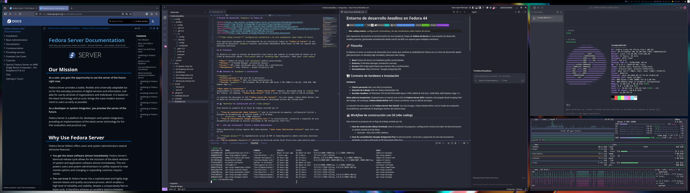

# Entorno de desarrollo *headless* en Fedora 44


> **Estación SDD:** entorno minimalista y de alto rendimiento sobre Fedora 44 Server para desarrollo guiado por especificaciones (*spec-driven development*).

Este repositorio documenta la transformación de una instalación limpia de **Fedora 44 Server** en una estación de desarrollo *headless* potente, gestionada remotamente desde macOS vía RDP con soporte para múltiples monitores.

## 🚀 Filosofía

El objetivo es tener un entorno de desarrollo Linux nativo que combine la estabilidad de Fedora con un ritmo de desarrollo rápido (*fast-paced* pero no *bleeding edge* inestable), ideal para desarrollo guiado por especificaciones (SDD) con asistentes de IA.

- **Base:** Fedora 44 Server (sin *bloatware* gráfico preinstalado).
- **Entorno:** i3 Window Manager (instalación manual).
- **Acceso:** RDP (xrdp) optimizado para clientes Mac y multimonitor.
- **Herramientas:** Ghostty + VS Code Insiders + Claude Code.
- **Automatización:** Ansible configura el servidor; Terraform crea opcionalmente una VM equivalente en macOS.

## 🏗 Contexto de *hardware* e instalación

***Hardware:***
- **Cliente personal:** Mac mini M4 (3 monitores).
- **Estación de trabajo:** Dell con Fedora Workstation 44.
- **Servidor *headless*:** HP EliteDesk 705 G4 DM 65W (AMD Ryzen 5 PRO 2400G @ 3.60 GHz, 32GB RAM, AMD Radeon Vega 11).

**Nota sobre la instalación:**
Originalmente se intentó usar la ISO de **Fedora Server DVD** completa, descargada desde la *laptop* Dell del trabajo. Sin embargo, **Fedora Media Writer** falló 3 veces al intentar crear la USB de arranque.

La solución fue descargar la ISO **Fedora Server Net Install**. Con esta imagen, Fedora Media Writer creó el medio de instalación sin problemas, permitiendo el despliegue exitoso del sistema base.

## 📐 Desarrollo guiado por especificaciones (SDD)

A partir de 2026-10-19, el repositorio se gestiona con [OpenSpec](https://github.com/Fission-AI/OpenSpec): todo cambio al entorno parte de una especificación acordada antes de tocar el sistema.

```
openspec/
├── config.yaml      # contexto del proyecto y reglas para los artefactos
├── specs/           # especificaciones vigentes (fuente de verdad)
└── changes/         # propuestas en curso y archivo de cambios aplicados
```

**Flujo de trabajo:**

1. **Proponer:** `/opsx:propose "<idea>"` genera `proposal.md`, `design.md`, `tasks.md` y los *deltas* de especificación.
2. **Aplicar:** `/opsx:apply` implementa las tareas del cambio (docs, `config/`, *scripts*).
3. **Archivar:** `/opsx:archive` integra los *deltas* en `openspec/specs/` y mueve el cambio a `changes/archive/`.

Los comandos `/opsx:*` están en `.claude/` y funcionan en Claude Code, tanto en la terminal como en la extensión de VS Code Insiders. Las instrucciones para agentes están en [AGENTS.md](AGENTS.md).

## 🤖 Historia de construcción con IA

Antes de adoptar SDD, el entorno se construyó con un flujo de trabajo asistido por IA más informal:

1.  **Fase de construcción (Warp Terminal):** toda la instalación de paquetes, configuración inicial y borrador de documentación se realizó usando la IA de Warp.
    *   *Inversión:* ~$20 USD (1000 créditos).
2.  **Fase de consolidación (Google Antigravity Pro):** la estructuración, corrección y expansión de esta documentación detallada se realizó utilizando el IDE Antigravity (Plan Pro).

Con la adopción de SDD, ambas herramientas se reemplazaron por Claude Code, VS Code Insiders y Ghostty.

## ❓ ¿Por qué «artesanal»? (frente a Fedora Workstation)

Fedora Workstation incluye soporte RDP sobre Wayland, **pero tiene limitaciones críticas** para este caso de uso:

1.  ***Single monitor*:** la implementación actual de RDP en Gnome/Wayland no admite múltiples monitores virtuales.
2.  **No es realmente *headless*:** requiere un inicio de sesión local físico tras cada reinicio para desbloquear el llavero (*keyring*) y permitir conexiones remotas.

Esta instalación manual sobre **Fedora Server** elimina la dependencia de GDM/Gnome, permitiendo un **inicio de sesión 100 % remoto** y soporte nativo para **3 monitores** desde el cliente RDP de Mac.

**Clientes RDP probados:**
- **macOS:** Microsoft Remote Desktop — 3 monitores 1080p ✔️
- **Linux:** Remmina (Fedora 44) — *ultrawide* 32:9 @ 5120×1440 ✔️


*Vista del entorno en display ultrawide 32:9 (5120×1440)*

## 📚 Guía de instalación

Sigue los documentos en orden para replicar este entorno desde cero:

### 1. [Preparación del sistema](docs/01-System_Prep.md)
Configuración inicial crítica para un sistema *headless*: gestión de energía (evitar suspensión), actualizaciones y seguridad SSH.

### 2. [Entorno gráfico minimalista](docs/02-Graphical_Env.md)
Instalación manual de las «X» y el entorno gráfico.
- `i3` + `i3blocks`
- Fuentes (Nerd Fonts) y temas (Dracula)
- Terminal Ghostty y utilidades base (Thunar, xfce4-terminal de respaldo)

### 3. [Acceso remoto (RDP)](docs/03-RDP.md)
Configuración de `xrdp` para permitir una experiencia fluida desde macOS.
- *Fixes* para teclado Mac.
- *Workarounds* para *wallpapers*.
- Gestión de sesiones.

### 4. [Configuración y personalización](docs/04-Configuration.md)
El «mojo» del sistema. Personalización visual y funcional.
- ***Shell*:** Zsh + Oh My Zsh + Powerlevel10k.
- **IDE y asistente:** VS Code Insiders y Claude Code.
- **Estética:** tema Dracula global.

### 5. [Mantenimiento](docs/05-Maintenance.md)
*Cheat sheet* de comandos y referencia rápida para el día a día.

### 6. [Tema Dracula](docs/06-Dracula_Theme.md)
Instalación completa del tema Dracula para GTK, iconos y Qt.

### 7. [Infraestructura como código](docs/07-IaC.md)
Automatización de las guías anteriores.
- Ansible: un *playbook* para bare metal y VM.
- Terraform + libvirt: VM Fedora aarch64 en un Mac con Apple Silicon, como alternativa a bare metal.

## 🛠 *Stack* tecnológico

| Componente | Elección | Razón |
| :--- | :--- | :--- |
| **Distro** | Fedora 44 Server | Base sólida, actualizaciones rápidas de *kernel*/paquetes. |
| **WM** | i3 | Ligero, *tiling* perfecto para *dev*, bajo consumo en RDP. |
| **Terminal** | Ghostty / xfce4 | Rápida, nativa y configurable en texto plano; xfce4 de respaldo. |
| **IDE** | VS Code Insiders | Últimas funciones de VS Code y extensión de Claude Code. |
| **Asistente IA** | Claude Code | Agente en terminal e IDE; ejecuta el flujo SDD de OpenSpec. |
| **IaC** | Ansible + Terraform | Entorno reproducible en bare metal o en una VM sobre macOS. |
| **Remoto** | Microsoft RDP (Mac) | Soporte nativo multimonitor y redirección de dispositivos. |

---

*Este proyecto fue elaborado por Rodrigo Álvarez (@incognia) y se distribuye bajo la licencia GPLv3. Para más detalles, consulta el archivo [LICENSE](LICENSE).*

*Copyright © 2026, Rodrigo Ernesto Álvarez Aguilera. Este es software libre bajo los términos de la GNU General Public License v3.*
